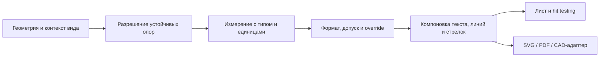

# Размеры на чертежах — каталог инструментов для BendCore CAD Pro

Дата проверки: **2026-11-02**. Статус: **исследование и проектная спецификация**, а не реализация размерных команд.

Сводка: **126 возможностей в 16 группах**, 26 первичных источников по **четырём CAD-системам**. Машиночитаемая версия: [DRAWING_DIMENSION_TOOLKIT.json](DRAWING_DIMENSION_TOOLKIT.json). Связанные каталоги: [текст и аннотации](DRAWING_TEXT_TOOLKIT.md), [таблицы](DRAWING_TABLE_TOOLKIT.md).

Каталог объединяет подтверждённые функциональные образцы и требования BendCore. Это **не исчерпывающий аудит всех CAD**, редакций, лицензий и стандартов. Наличие функции у одного продукта не переносится на остальные. Для непроверенных систем не выставлены ни «есть», ни «нет».

Все ID `DIM-*` имеют `status: planned`, `runtimeIntegration: false`. Существующие команды `TXT-046`, `TXT-047`, кнопка «Размер линии» и ручные GD&T-аннотации не считаются реализацией нового каталога. `foundation/partial` в JSON описывает только ограниченную основу текущего кода.

База анализа кода: `e804ed2b679f13ef73a22e055e3d84b3d6d0d921` — main после [PR #10](https://github.com/Do4ent/CADGUI/pull/10). Каталог таблиц из [PR #11](https://github.com/Do4ent/CADGUI/pull/11) объединён в main отдельно; он не меняет размерную модель.

## Главный вывод

Размер — семантическая сущность: **опоры → измерение → числовой формат/допуск → текст и геометрия оформления**. Просто надпись с числом и стрелками не заменяет эту модель. Префикс Ø к длине линии не превращает её в диаметр; строка ±0.1 не является структурированным допуском.

В первую очередь BendCore нужен полноценный измеряемый 2D-размер, у которого **значение, размерная линия, выносные и стрелки перестраиваются вместе**. Сейчас по источнику обновляется число, а условный размерный символ рисуется по своему контейнеру.

## Термины и границы подсистем

| Понятие | Смысл | Граница BendCore |
| --- | --- | --- |
| Измеряющий размер / driven | Читает геометрию и показывает вычисленную величину | Базовый режим чертежа; редактирование подписи не меняет источник |
| Управляющий размер / driving | Ограничение, значение которого управляет геометрией | Нужен constraint solver; обычное изменение `pos/size` не эквивалентно решению ограничений |
| Справочный размер на чертеже | Специальный статус/оформление размера по выбранному стандарту | Не синоним всех driven-размеров и не переключатель solver |
| Размер на бумаге | Расстояние в координатах листа | Не следует автоматически выдавать его за размер исходной модели |
| Проекционный размер вида | Измерение спроецированной геометрии с известным контекстом и масштабом | Обратный масштаб не восстанавливает скрытую 3D-компоненту |
| Истинная 3D-величина | Метрика исходных 3D-опор и выбранной плоскости/типа | Нужен проверенный geometry adapter, а не эвристика по экрану или bbox |
| Оформление размера | Текст, линии, стрелки, разрывы, масштаб оформления | Меняет видимость/читаемость, а не номинал |
| Размерный допуск | Отклонения/пределы относительно номинала | Отдельная типизированная величина с единицами и правилами вывода |
| GD&T и базы | Характеристика, зона, модификаторы и datum references | Валидация обозначения не равна проверке геометрии детали на соответствие допуску |
| 3D PMI | Семантическая аннотация модели с 3D-опорами, плоскостью и видами | Текст SVG или статический PDF не является PMI |
| Нормативный профиль | Стандарт, редакция, правила оформления/допусков | ISO/ASME/ГОСТ не взаимозаменяемы; наличие пресета не означает сертификацию |

## Сравнение проверенных функциональных образцов

| Система | Что подтверждено | Что использовать как образец / ограничение |
| --- | --- | --- |
| GstarCAD 2026 | Линейные/угловые/R/Ø, цепочки, базовые, ordinate, arc length, jogged, quick; styles/fit/units/tolerances; inspection и GD&T | Широкий 2D-набор и отделение size/format/scale. Источник — §9 официального PDF, а не проверка каждой команды в установленной CAD. S01–S04 |
| FreeCAD TechDraw / Sketcher | Измерение опор, projected/true, радиусы/углы, chain/base extensions, repair, axonometric, формат и допуски | Разделить геометрические ссылки и оформление; учесть topological naming. Driving/reference показаны отдельно на примере Sketcher. GD&T-страница описывает и обходные приёмы, не полный semantic backend. S05–S12, S23–S26 |
| LibreCAD 2.2.x | Базовые 2D-размеры, snaps, предпочтения текста/стрелок/выносных, general scale отдельно от length factor, числовые форматы | Сначала предсказуемый 2D workflow и единицы. Руководство развивается; наличие snaps не доказывает ассоциативность всех размеров. S13–S15 |
| QCAD master | Aligned, angular, radial, diametric, ordinate, ввод подписи/допусков и выбор положения линий | Компактный contextual workflow: источники → положение → подтверждение. По репозиторию не сделаны выводы о лицензировании каждой редакции. S16–S22 |

AutoCAD, BricsCAD, DraftSight, ZWCAD, nanoCAD, КОМПАС-3D, T-FLEX CAD, SOLIDWORKS, Inventor, Fusion, Creo, NX, Solid Edge, CATIA и Rhino — кандидаты расширения сравнения. Их ранее проверенные страницы о тексте/таблицах не использованы как доказательство размерных функций. Для настоящего каталога проверены только перечисленные источники, остальные функции отмечены как проектные требования.

## Первичные источники

Официальные репозитории FreeCAD, QCAD и LibreCAD прочитаны через GitHub. GstarCAD — ранее полученный официальный PDF, повторно прочитан раздел Dimensions and Tolerances. FreeCAD-документация архивирована и содержит сведения разных версий; это свидетельство описанной функции, не гарантия актуального API. Даты/версии и ограничения приведены отдельно для каждого источника.

| ID | Продукт / версия | Источник и граница проверки |
| --- | --- | --- |
| S01 | GstarCAD · 2026 | [User Guide §9.1, печатные стр. 127–132](https://cdn-sg-gw.gstarcad.net/gstarsoft_pdf/GstarCAD_2026_User_Guide.pdf). Линейные, aligned/rotated, baseline/chain, угловые, R/Ø, jogged, ordinate, quick и arc length. PDF прочитан локально. |
| S02 | GstarCAD · 2026 | [User Guide §9.2, стр. 132–137](https://cdn-sg-gw.gstarcad.net/gstarsoft_pdf/GstarCAD_2026_User_Guide.pdf). Размерные стили, стрелки, fit, позиция текста, primary/alternate units, допуски и масштаб. Не нормативная сертификация. |
| S03 | GstarCAD · 2026 | [User Guide §9.3, стр. 138–140](https://cdn-sg-gw.gstarcad.net/gstarsoft_pdf/GstarCAD_2026_User_Guide.pdf). Переопределения стиля, oblique/jogged linear, inspection и DIMSPACE. |
| S04 | GstarCAD · 2026 | [User Guide §9.4, стр. 140–142](https://cdn-sg-gw.gstarcad.net/gstarsoft_pdf/GstarCAD_2026_User_Guide.pdf). Feature control frames, material conditions, datums, projected zones и composite tolerances. Правила конкретной редакции ISO/ASME не верифицированы. |
| S05 | FreeCAD · Документация main, содержит различия 0.21/1.0 | [TechDraw LengthDimension](https://github.com/FreeCAD/FreeCAD-documentation/blob/main/wiki/TechDraw_LengthDimension.md). Линия/точки/перпендикулярные расстояния; projected/true, допуски, формат, overrides; ограничения topological naming. |
| S06 | FreeCAD · Документация main | [TechDraw AngleDimension](https://github.com/FreeCAD/FreeCAD-documentation/blob/main/wiki/TechDraw_AngleDimension.md). Внутренний угол двух прямых рёбер; ссылки на 2D/3D и свойства размера. |
| S07 | FreeCAD · Документация main | [TechDraw RadiusDimension](https://github.com/FreeCAD/FreeCAD-documentation/blob/main/wiki/TechDraw_RadiusDimension.md). Радиус окружности/круговой дуги; эллипс или B-spline, выглядящий кругом, не подходит. |
| S08 | FreeCAD · Документация main | [TechDraw Workbench — Dimensions](https://github.com/FreeCAD/FreeCAD-documentation/blob/main/wiki/TechDraw_Workbench.md). Список видов размеров, горизонтальные/вертикальные extents, цепочки, координатные серии, фаски и форматирование. |
| S09 | FreeCAD · С версии 0.21 по документу | [TechDraw DimensionRepair](https://github.com/FreeCAD/FreeCAD-documentation/blob/main/wiki/TechDraw_DimensionRepair.md). Замена 2D/3D геометрических ссылок после topological naming/hidden-line изменений. |
| S10 | FreeCAD · В описании GD&T указаны ограничения 0.20 | [TechDraw GD&T](https://github.com/FreeCAD/FreeCAD-documentation/blob/main/wiki/TechDraw_Geometric_dimensioning_and_tolerancing.md). Формат и допуски; для части GD&T применяются обходные приёмы через balloons. Не доказательство полноценного семантического GD&T. |
| S11 | FreeCAD · 0.21/0.22 по документу | [TechDraw AxoLengthDimension](https://github.com/FreeCAD/FreeCAD-documentation/blob/main/wiki/TechDraw_AxoLengthDimension.md). Направления размерной и выносных линий в аксонометрии; true measurement требует исходных ссылок. |
| S12 | FreeCAD · С версии 0.20 по документу | [Horizontal Coordinate Dimensions](https://github.com/FreeCAD/FreeCAD-documentation/blob/main/wiki/TechDraw_ExtensionCreateHorizCoordDimension.md). Несколько равномерно размещённых размеров от общей базы. Название coordinate здесь не делает их автоматически ordinate X/Y. |
| S13 | LibreCAD · Руководство 2.2.x, main | [Drawing Tools — Dimension](https://github.com/LibreCAD/docs/blob/main/ref/tools.rst). Aligned/linear/horizontal/vertical/radius/diameter/angular. Открытая документация отмечена как развиваемая. |
| S14 | LibreCAD · Руководство 2.2.x, main | [Drawing Preferences — Dimensions](https://github.com/LibreCAD/docs/blob/main/ref/draw-prefs.rst). General scale отдельно от length factor; text/extension/arrow параметры, format units, точность и подавление нулей. |
| S15 | LibreCAD · Руководство 2.2.x, main | [Snapping](https://github.com/LibreCAD/docs/blob/main/ref/snaps.rst). Концы, центры, середины, пересечения, координатные ограничения; это механизм выбора, а не гарантия ассоциативности размера. |
| S16 | QCAD · master на дату проверки; редакция лицензии не аудирована | [Dimension Tools](https://github.com/qcad/qcad/blob/master/scripts/Draw/Dimension/doc/Dimension_en.html). Размер состоит из значения, линий, стрелок и допусков; параметры вводятся на contextual toolbar. |
| S17 | QCAD · master на дату проверки | [Aligned](https://github.com/qcad/qcad/blob/master/scripts/Draw/Dimension/DimAligned/doc/DimAligned_en.html). Две точки выносных линий и положение размерной линии; линия параллельна измеряемому отрезку. |
| S18 | QCAD · master на дату проверки | [Ordinate — описание](https://github.com/qcad/qcad/blob/master/scripts/Draw/Dimension/DimOrdinate/doc/DimOrdinate_desc_en.mdx). Координата X или Y относительно начала. |
| S19 | QCAD · master на дату проверки | [Ordinate — порядок работы](https://github.com/qcad/qcad/blob/master/scripts/Draw/Dimension/DimOrdinate/doc/DimOrdinate_proc_en.mdx). Выбор точки/полки; origin можно менять перетаскиванием или свойствами. |
| S20 | QCAD · master на дату проверки | [Angular](https://github.com/qcad/qcad/blob/master/scripts/Draw/Dimension/DimAngular/doc/DimAngular_en.html). Две опорные линии и положение размерной дуги. |
| S21 | QCAD · master на дату проверки | [Radial](https://github.com/qcad/qcad/blob/master/scripts/Draw/Dimension/DimRadial/doc/DimRadial_en.html). Окружность или дуга; положение радиальной линии. |
| S22 | QCAD · master на дату проверки | [Diametric](https://github.com/qcad/qcad/blob/master/scripts/Draw/Dimension/DimDiametric/doc/DimDiametric_en.html). Диаметр окружности или дуги; не подстановка символа к длине линии. |
| S23 | FreeCAD · С версии 0.20 по документу | [Horizontal Chamfer Dimension](https://github.com/FreeCAD/FreeCAD-documentation/blob/main/wiki/TechDraw_ExtensionCreateHorizChamferDimension.md). Размер фаски как горизонтальный размер и угол по двум вершинам. |
| S24 | FreeCAD · С версии 0.16 по документу | [Sketcher ToggleDrivingConstraint](https://github.com/FreeCAD/FreeCAD-documentation/blob/main/wiki/Sketcher_ToggleDrivingConstraint.md). Отличает driving constraints и reference/driven. Это Sketcher, не команда TechDraw. |
| S25 | FreeCAD · С версии 0.20 по документу | [Arc Length Dimension](https://github.com/FreeCAD/FreeCAD-documentation/blob/main/wiki/TechDraw_ExtensionCreateLengthArc.md). Длина круговой дуги как отдельная величина, не хорда. |
| S26 | FreeCAD · С версии 0.20 по документу | [Cascade Horizontal Dimensions](https://github.com/FreeCAD/FreeCAD-documentation/blob/main/wiki/TechDraw_ExtensionCascadeHorizDimension.md). Равномерные интервалы относительно первого размера и центрирование текста. |

## Что уже есть в BendCore

| Область | Существующая основа | Ограничение |
| --- | --- | --- |
| Модель | `src/drawing/types.ts`: `annotation.type: dimension`, `sourceId`, префикс/суффикс, строковые fields | Нет отдельного типа измерения, двух опор, view context, размерных стилей или типизированного допуска |
| Создание | `DrawingWorkspace.tsx`: выбранная линия с двумя точками, положительная конечная длина, inline error | Создание внутри Workspace; положение `source.x`, `source.y+10`, без параметрического диалога. Ориентация источника не переносится |
| Вычисление | `model.ts`: евклидова длина двух локальных точек, устойчивая к переносу/повороту | Это полная 2D-длина, не горизонтальная/вертикальная проекция и не истинная 3D-величина |
| Связь | `plainText` пересчитывает число из текущего источника | Значение ассоциативно, геометрия размерных/выносных линий — нет |
| Размерный символ | `render/EntityGraphic.tsx`: линии и условные стрелки внутри `width/height` аннотации | Концы символа не привязаны к концам источника; нет вычисляемого offset/fit/зазоров/типов стрелок |
| Текст | TXT-047 добавляет префикс/суффикс, сохраняя sourceId | Строка Ø не меняет тип измерения; SymbolGraphic использует plainText, не полноценный размерный rich-text layout |
| Точность | `fields.precision`, по умолчанию 3, вывод ограничен 0–8 знаками | Нет UI; `String(Number(...))` удаляет завершающие нули. Нет выбранного правила округления/локали |
| Единицы и масштаб | Измерение в координатах drawing-линии; текстовый суффикс | Нет unit conversion или view scale policy; `sheet.scale` не участвует в значении |
| Допуски | TXT-046 создаёт ручной stack в тексте; TXT-047 может добавить текст ±0.1 | Нет nominal/upper/lower, limits/fit и проверки согласованности допуска |
| GD&T | Ручные symbol/gdt/datum-аннотации с полями | Не полная модель FCF/datums/modifiers и не проверка соответствия стандартам |
| Диагностика | Потерянный sourceId даёт предупреждение и ⟦нет источника⟧ | Если ID есть, но геометрия стала неподходящей, отдельная полноценная диагностика размерной связи отсутствует; нулевая линия после изменения может показать 0 |
| История/документы | Native JSON, dirty guards, undo/redo чертежа | Нет миграции к полноценному DimensionModel или отдельного solver workflow |
| Обмен | SVG/PDF текущей отрисовки; DXF как статический TEXT/MTEXT с предупреждением | Не DXF DIMENSION, не associative round-trip, не PMI; графика условного размерного символа в DXF не сохраняется |
| Тесты | `drawingLength.test.cjs`, `e2e/test_drawing.py`, `e2e/test_drawing_review.py` | Есть длина/трансформации/источник/префикс/ошибки; нет проекций, допусков, полноценных выносных и DIMENSION round-trip |

Отметки в каталоге: **нет** — нужный workflow отсутствует; **основа** — только общий примитив/частичная отрисовка; **частично** — есть ограниченный текущий путь. **Готовых зарегистрированных DIM-команд этим анализом не добавлено.**

## Группы и приоритеты

A — измеряемые 2D-размеры и сохранность; B — группы, оформление, допуски и документация; C — отдельные solver/3D/feature/normative/PMI адаптеры. Порядок не отменяет [общую roadmap](IMPLEMENTATION_ROADMAP.md).

| Группа | ID | Количество |
| --- | --- | --- |
| Линейные размеры | DIM-001–DIM-008 | 8 |
| Углы, радиусы, диаметры и дуги | DIM-009–DIM-016 | 8 |
| Цепочки, базы и координатные системы размеров | DIM-017–DIM-023 | 7 |
| Выбор геометрии и опор | DIM-024–DIM-030 | 7 |
| Размещение и читаемость | DIM-031–DIM-038 | 8 |
| Ассоциативность и восстановление связей | DIM-039–DIM-046 | 8 |
| Размерные стили и наследование | DIM-047–DIM-053 | 7 |
| Значения, единицы и числовой формат | DIM-054–DIM-061 | 8 |
| Текст, символы и ручная подмена | DIM-062–DIM-069 | 8 |
| Допуски размеров и посадки | DIM-070–DIM-077 | 8 |
| Размерные линии, выносные и стрелки | DIM-078–DIM-084 | 7 |
| Масштаб, виды и плоскости измерения | DIM-085–DIM-092 | 8 |
| Редактирование и массовые действия | DIM-093–DIM-099 | 7 |
| Специальные размерные команды | DIM-100–DIM-107 | 8 |
| Геометрические допуски, базы и PMI | DIM-108–DIM-115 | 8 |
| Автоматизация, обмен и контроль | DIM-116–DIM-126 | 11 |

Всего: **126**, этап A — 48, B — 52, C — 26.

## Полный каталог

Ссылки подтверждают **функциональный образец**, не весь будущий контракт и не функцию во всех системах. Валидация, стабильные ID, правила потерь и транзакций — требования BendCore поверх образцов. `BendCore` без номера источника означает собственное проектное требование. Все строки planned.

### 1. Линейные размеры

Зависимости: geometry-2d-adapter, dimension-model.

| ID | Инструмент | Этап | Целевое поведение | Основание | Сейчас |
| --- | --- | --- | --- | --- | --- |
| DIM-001 | Горизонтальный размер | A | Измерять абсолютную проекцию разности опор на ось X выбранной системы координат, а не полную длину отрезка. | S01, S13 | нет |
| DIM-002 | Вертикальный размер | A | Измерять проекцию на ось Y с явной системой координат и политикой знака. | S01, S13 | нет |
| DIM-003 | Параллельный размер по двум точкам | A | Полная длина между опорами; размерная линия параллельна отрезку, выносные связаны с его концами. | S01, S05, S17 | основа |
| DIM-004 | Размер по заданному направлению | A | Проекция на пользовательскую ось; угол размерной линии не подменяет произвольное вращение подписи. | S01, S13 | нет |
| DIM-005 | Перпендикуляр от точки до линии | A | Выбрать конечный отрезок либо бесконечную опорную прямую; правило ближайшей точки задаётся явно. | S05 | нет |
| DIM-006 | Расстояние между параллельными линиями | A | Проверить параллельность с численным допуском и вычислить кратчайшее расстояние. | S05 | нет |
| DIM-007 | Габаритный размер по X/Y | B | Измерять экстремумы выбранной геометрии в системе вида; bbox текста и рамка выделения не источник размера. | S08 | нет |
| DIM-008 | Контекстное создание размера | B | По типу выбранной геометрии предложить совместимый вид; показать выбор до создания, не угадывать тип молча. | S08 | нет |

### 2. Углы, радиусы, диаметры и дуги

Зависимости: circle-arc-geometry, angle-policy.

| ID | Инструмент | Этап | Целевое поведение | Основание | Сейчас |
| --- | --- | --- | --- | --- | --- |
| DIM-009 | Радиус окружности или дуги | A | Измерять радиус реальной круговой геометрии; эллипс и визуально похожий сплайн отклонять. | S01, S07, S21 | нет |
| DIM-010 | Диаметр окружности или дуги | A | Получать диаметр из окружности; префикс Ø к длине линии не является диаметральным измерением. | S01, S22 | нет |
| DIM-011 | Угол между двумя прямыми | A | Опорные направления и выбранный сектор определяют внутренний/внешний угол; вырожденные линии отклоняются. | S01, S06, S20 | нет |
| DIM-012 | Угол по трём точкам | A | Средняя точка — вершина, остальные задают лучи; обработать совпадения и переход через 0/360°. | S01, S08 | нет |
| DIM-013 | Угловой размер круговой дуги | B | Измерять центральный угол конкретного параметрического участка с учётом направления дуги. | S01 | нет |
| DIM-014 | Длина круговой дуги | B | Измерять r·угол в радианах, а не хорду или длину полного круга; хранить участок источника. | S01, S25 | нет |
| DIM-015 | Радиус с изломом | B | Вынести условный центр и добавить jog без изменения истинного значения и ссылки на окружность. | S01 | нет |
| DIM-016 | Сферические радиус и диаметр | C | Требуется подтверждённая сферическая поверхность/3D-источник; текст SR/SØ сам по себе не измеряет сферу. | BendCore | нет |

### 3. Цепочки, базы и координатные системы размеров

Зависимости: dimension-sets, datum-origin.

| ID | Инструмент | Этап | Целевое поведение | Основание | Сейчас |
| --- | --- | --- | --- | --- | --- |
| DIM-017 | Размерная цепочка | B | Последовательные интервалы имеют общие опоры; добавление звена сохраняет смысл предыдущих размеров. | S01, S08 | нет |
| DIM-018 | Размеры от общей базы | B | Все размеры используют одну базовую опору и независимые конечные опоры; не путать с последовательной цепочкой. | S01, S12 | нет |
| DIM-019 | Ординатные размеры X/Y | B | Выводить координату точки от заданного нуля; явная ось и знак, начало хранится как общая опора. | S01, S18, S19 | нет |
| DIM-020 | Полярные координатные размеры | C | Задать начало, нулевое направление, радиус и угол; явно выбрать поддерживаемую семантику представления. | BendCore | нет |
| DIM-021 | Изменение нуля координатной группы | B | Переназначить общую опору с предпросмотром всех изменившихся координат и одним undo-шагом. | S19, BendCore | нет |
| DIM-022 | Редактирование состава цепочки/базы | B | Вставить, удалить или переупорядочить звено без дублирования источников и скрытого разрыва группы. | BendCore | нет |
| DIM-023 | Полки и изломы ординатных размеров | B | Маршрут выноски изменяет читаемость, но не начало отсчёта, знак или измеряемую координату. | S01, S19, BendCore | нет |

### 4. Выбор геометрии и опор

Зависимости: stable-reference, snap-service, coordinate-frame.

| ID | Инструмент | Этап | Целевое поведение | Основание | Сейчас |
| --- | --- | --- | --- | --- | --- |
| DIM-024 | Привязки к концам, серединам и центрам | A | Различать тип привязки и хранить связь с сущностью/параметром; просто скопированные XY не являются ассоциативной опорой. | S15 | основа |
| DIM-025 | Касательная и виртуальное пересечение | B | Хранить правило построения виртуальной опоры и зависимые объекты, а не случайную экранную точку. | S15, BendCore | нет |
| DIM-026 | Локальная система координат | B | Выбрать origin и базис для координат, углов и проекций; сохранять матрицу/ID контекста. | S01, S18 | нет |
| DIM-027 | Подсветка кандидатов источника | A | Перед подтверждением показать обе опоры, измеряемый участок и единицы, исключить случайный выбор текстовой рамки. | BendCore | основа |
| DIM-028 | Ссылки на исходную 3D-геометрию | C | Использовать устойчивую ссылку на ребро/вершину/поверхность и view context; не считать pos/size примитива точной топологией. | S05, S09 | нет |
| DIM-029 | Неассоциативный размер по точкам | A | Разрешить ручные координаты как явно несвязанный источник; индикатор отличает его от ассоциативного размера. | S17, BendCore | нет |
| DIM-030 | Проверка пригодности опор | A | Отсекать NaN, бесконечность, недопустимые типы, совпавшие опоры и неразрешимые случаи до изменения документа. | S05, S07 | частично |

### 5. Размещение и читаемость

Зависимости: dimension-layout, text-metrics, hit-testing.

| ID | Инструмент | Этап | Целевое поведение | Основание | Сейчас |
| --- | --- | --- | --- | --- | --- |
| DIM-031 | Положение размерной линии | A | Перемещать линию как геометрический offset относительно опор, автоматически перестраивая выносные. | S01, S17 | основа |
| DIM-032 | Перемещение текста размера | A | Текст перемещается отдельно от измерения и при необходимости получает соединительную линию. | S02, S05 | основа |
| DIM-033 | Текст и стрелки внутри/снаружи | A | Проверять доступное место по метрикам и выбранной fit-политике; не менять измеряемые опоры. | S02 | нет |
| DIM-034 | Разворот стрелок | A | Независимый flip наконечников без инверсии знака или изменения длины. | S05 | нет |
| DIM-035 | Выравнивание размерных линий | B | Выбранный размер задаёт базовую линию; совместимые размеры выравниваются без пересчёта геометрии источника. | S03, S08 | нет |
| DIM-036 | Равномерные интервалы между размерами | B | Задать расстояние на бумаге, сохранить первый размер и развести остальные с одним подтверждением. | S03, S26 | нет |
| DIM-037 | Разрыв и излом размерной линии | B | Локальные графические разрывы/jog не меняют значение; отличать их от разрыва вида и удаления источника. | S03 | нет |
| DIM-038 | Пересечения линий и маска текста | B | Проверять коллизии и область маски; маска не скрывает предупреждение о сломанной ссылке. | BendCore | основа |

### 6. Ассоциативность и восстановление связей

Зависимости: reference-resolver, dependency-graph.

| ID | Инструмент | Этап | Целевое поведение | Основание | Сейчас |
| --- | --- | --- | --- | --- | --- |
| DIM-039 | Устойчивые ссылки на опоры | A | Хранить ID сущности и тип/параметр опоры; числовой индекс ребра без политики перестроения недостаточен. | S05, S09, BendCore | основа |
| DIM-040 | Пересчёт при изменении источника | A | Перестроить и значение, и размерные/выносные линии; обновления только числа недостаточно. | S05, BendCore | частично |
| DIM-041 | Диагностика потерянной ссылки | A | Показать причину и подсветить размер; не выдавать сохранённый кэш за актуальный результат. | S09, BendCore | частично |
| DIM-042 | Перепривязка размера | B | Выбрать новые совместимые опоры и показать изменившееся значение до применения. | S09 | нет |
| DIM-043 | Заморозить результат снимком | B | Сохранить значение, геометрию и происхождение как явно устаревающий снимок, не менять исходный объект. | BendCore | нет |
| DIM-044 | Разорвать ассоциативность | B | Преобразовать связь в явные опоры/снимок с предупреждением и возможностью отмены. | BendCore | нет |
| DIM-045 | Показать геометрию и зависимости | A | Выделение размера подсвечивает источники, базу и контекст вида; обратный переход выбирает зависимые размеры. | BendCore | основа |
| DIM-046 | Изменившийся тип или топология источника | B | Существующий ID с неподходящим типом считается ошибкой связи; попытка восстановления не выбирает похожее ребро молча. | S05, S09, BendCore | нет |

### 7. Размерные стили и наследование

Зависимости: dimension-style-schema, style-library.

| ID | Инструмент | Этап | Целевое поведение | Основание | Сейчас |
| --- | --- | --- | --- | --- | --- |
| DIM-047 | Менеджер размерных стилей | A | Именованный стиль связывает линии, стрелки, текст, единицы, fit и допуски; хранится в документе. | S02 | нет |
| DIM-048 | Варианты стиля по типу размера | B | Отдельные параметры линейных, угловых и радиальных размеров без несогласованного копирования стиля. | S02, BendCore | нет |
| DIM-049 | Локальные переопределения | A | Показать отличие от стиля и источник каждого эффективного значения. | S03 | основа |
| DIM-050 | Копировать оформление размера | A | Передать стиль/переопределения без замены опор, измерения, допусков и ручного override значения. | S03, BendCore | основа |
| DIM-051 | Сбросить переопределения | A | Восстановить наследуемые параметры с предпросмотром; номинал и источник остаются прежними. | S03 | основа |
| DIM-052 | Профили ISO, ASME и ГОСТ | B | Явно выбрать стандарт и редакцию; профиль оформления не является заявлением о сертифицированном соответствии. | BendCore | нет |
| DIM-053 | Импорт и конфликты стилей | B | Сравнить одинаковые имена/разные параметры; сохранить ссылки или создать отдельный стиль без скрытой замены. | BendCore | нет |

### 8. Значения, единицы и числовой формат

Зависимости: typed-measurement, unit-conversion, number-format.

| ID | Инструмент | Этап | Целевое поведение | Основание | Сейчас |
| --- | --- | --- | --- | --- | --- |
| DIM-054 | Основные единицы размера | A | Линейные и угловые величины имеют размерность и формат; единица источника не берётся из суффикса подписи. | S02, S14 | нет |
| DIM-055 | Точность отображения | A | Задать число десятичных знаков независимо от точности вычисления, включая обязательные завершающие нули. | S02, S05, S14 | основа |
| DIM-056 | Правило округления | A | Задать шаг и способ округления; арифметические пограничные случаи проверяются отдельно от форматирования строки. | S02, BendCore | нет |
| DIM-057 | Альтернативные единицы | B | Второй согласованный вывод имеет собственную точность/скобки; ограничения по типу величины явные. | S02 | нет |
| DIM-058 | Конвертация единиц и коэффициент значения | B | Отделить физическую конвертацию, user length factor и масштаб оформления; каждый коэффициент имеет происхождение. | S14, BendCore | нет |
| DIM-059 | Подавление ведущих/замыкающих нулей | A | Независимые настройки сохраняют знак и значение; 5 и 5.000 являются разными форматами одного результата. | S05, S14 | основа |
| DIM-060 | Дроби, футы/дюймы и угловые форматы | B | Поддерживать явный формат и знаменатель/точность; градусы-минуты-секунды не хранить как неразобранный текст. | S14 | нет |
| DIM-061 | Исходное измерение и отображаемое значение | A | Хранить raw measurement отдельно от format/override/cache; форматирование и текст не изменяют геометрию. | S05, BendCore | основа |

### 9. Текст, символы и ручная подмена

Зависимости: rich-text-adapter, measurement-placeholder.

| ID | Инструмент | Этап | Целевое поведение | Основание | Сейчас |
| --- | --- | --- | --- | --- | --- |
| DIM-062 | Префикс и суффикс | A | Добавлять текст вокруг вычисленного значения, не теряя ссылку на источник и номинал. | S01, S16 | частично |
| DIM-063 | Плейсхолдер вычисленного значения | A | Шаблон содержит структурированный слот числа; замена видимого текста не уничтожает измерение. | S05, BendCore | нет |
| DIM-064 | Фрагменты, дроби и многострочность | B | Переиспользовать rich-text движок для подписи размера; дробь/индекс не превращается автоматически в допуск. | S10, S16, BendCore | основа |
| DIM-065 | Инженерные символы подписи | A | Ø, R, □ и другие символы вводятся явно; семантика типа размера проверяется отдельно от глифа. | S08, S16 | основа |
| DIM-066 | Ориентация и читаемость текста | A | Текст вдоль размерной линии или горизонтально; правило переворота чтения задаётся стилем. | S02 | основа |
| DIM-067 | Ручная подмена подписи | B | Сохранить вычисленное число и показать override-индикатор в редакторе/отчёте; не выдавать текст за измерение. | S05 | нет |
| DIM-068 | Вернуть вычисленную подпись | B | Снять override без пересоздания геометрии, восстановив текущий результат и формат. | S05, BendCore | нет |
| DIM-069 | Шрифт и недостающие символы | A | Проверять выбранный шрифт и явную подстановку, включая ±/Ø/знаки допуска; glyph coverage не считать доказанной эвристикой. | S10, BendCore | основа |

### 10. Допуски размеров и посадки

Зависимости: typed-tolerance, standard-profile.

| ID | Инструмент | Этап | Целевое поведение | Основание | Сейчас |
| --- | --- | --- | --- | --- | --- |
| DIM-070 | Симметричный допуск | B | Хранить величину ±t отдельно от номинала; t конечен и неотрицателен. | S02, S05, S16 | нет |
| DIM-071 | Раздельные верхнее/нижнее отклонения | B | Хранить signed deviations, проверить порядок предельных значений и знак каждого отклонения. | S02, S05 | нет |
| DIM-072 | Предельные размеры | B | Вычислить lower/upper из номинала и отклонений; вывод пределов не меняет исходный номинал. | S02, BendCore | нет |
| DIM-073 | Обозначение поля допуска/посадки | B | Хранить структурированное обозначение, стандарт, редакцию и сторону отверстие/вал; неизвестный код не вычислять догадкой. | BendCore | нет |
| DIM-074 | Расчёт числовых отклонений посадки | C | Нужен проверенный нормативный набор данных по диапазонам и версии стандарта; без него доступно только явно ручное обозначение. | BendCore | нет |
| DIM-075 | Формат и точность допуска | B | Отдельные precision/scale/alignment верхней и нижней величин с согласованным знаком и единицами. | S02, S05, S10 | нет |
| DIM-076 | Теоретически точный размер | B | Рамка basic dimension — типизированная семантика; обычные ± отклонения с этим режимом несовместимы. | S05 | нет |
| DIM-077 | Справочный размер | B | Отделить обозначение справочного размера на чертеже от режима driven в solver; одно не включает другое автоматически. | S24, BendCore | нет |

### 11. Размерные линии, выносные и стрелки

Зависимости: dimension-layout, line-style.

| ID | Инструмент | Этап | Целевое поведение | Основание | Сейчас |
| --- | --- | --- | --- | --- | --- |
| DIM-078 | Типы наконечников и засечки | A | Стрелка/засечка задаётся параметром размера, возможны разные наконечники первого и второго конца. | S02, S14 | нет |
| DIM-079 | Размер стрелок | A | Задавать в единицах бумаги, не изменяя длину измеряемого объекта. | S02, S14 | нет |
| DIM-080 | Отступ выносной от источника | A | Сохранять разрыв между геометрией и выносной линией по стилю. | S02, S14 | нет |
| DIM-081 | Выход выносной за размерную линию | A | Отдельный параметр overshoot; направление следует геометрии размерной линии. | S02, S14 | нет |
| DIM-082 | Линии: толщина, тип и цвет | A | Размерные/выносные параметры раздельны; экран, SVG и PDF используют одну компоновку. | S02, S14 | основа |
| DIM-083 | Скрыть отдельную линию/стрелку | B | Скрывать графический компонент без удаления опоры и без подмены полного размера половинным. | S02, BendCore | нет |
| DIM-084 | Осевые линии и центровые отметки | B | Согласовать размер с отдельными осевыми объектами; центр метки не вычислять по bbox подписи. | BendCore | нет |

### 12. Масштаб, виды и плоскости измерения

Зависимости: view-context, projection-adapter, coordinate-frames.

| ID | Инструмент | Этап | Целевое поведение | Основание | Сейчас |
| --- | --- | --- | --- | --- | --- |
| DIM-085 | Размер текста на бумаге | A | Сохранять физическую высоту подписи независимо от экранного zoom и величины объекта. | S02, S14 | основа |
| DIM-086 | Аннотативные представления | B | Один размер может иметь размещение для нескольких масштабов; источники и результат не дублируются как разные измерения. | BendCore | нет |
| DIM-087 | Масштаб вида и коэффициент значения | B | Явно связать бумажное представление с координатами вида; не применять view scale повторно к уже модельному результату. | S02, S14 | нет |
| DIM-088 | Проекция или истинная 3D-величина | C | Projected использует геометрию вида, True — исходную 3D-геометрию; обратный масштаб 2D не восстанавливает скрытую компоненту. | S05 | нет |
| DIM-089 | Размер в аксонометрии | C | Плоскость, направления выносных и источник измерения заданы явно; нельзя угадать true value по экранному отрезку. | S11 | нет |
| DIM-090 | Укороченный/разорванный вид | C | Измерение идёт по исходной геометрии, а не видимому разрыву; сохраняется контекст специального представления. | BendCore | нет |
| DIM-091 | Разрезы, сечения и местные виды | C | Опора принадлежит исходному объекту и конкретному виду; скрытые и обрезанные участки имеют определённую политику выбора. | BendCore | нет |
| DIM-092 | Видимость размера по листу/виду | B | Не путать скрыто, непечатно и удалено; перенос между видами требует совместимости ссылок и плоскости. | BendCore | основа |

### 13. Редактирование и массовые действия

Зависимости: dimension-selection, validated-transactions.

| ID | Инструмент | Этап | Целевое поведение | Основание | Сейчас |
| --- | --- | --- | --- | --- | --- |
| DIM-093 | Параметрический диалог размера | A | Выбрать тип, опоры, offset, стиль, формат и допуск; черновик подтверждается или отменяется целиком. | S05 | нет |
| DIM-094 | Переместить или скопировать размер | A | Перемещать оформление отдельно от источника; копия получает свой ID и явно сохраняет/заменяет опоры. | BendCore | частично |
| DIM-095 | Смена типа размера | B | Преобразовывать только совместимые типы с предпросмотром; Ø длины линии запрещено выдавать за новый диаметр. | BendCore | нет |
| DIM-096 | Массовая смена стиля/слоя | B | Показать смешанные значения и затронутые объекты; не переносить случайно номиналы или допуски. | S03, BendCore | основа |
| DIM-097 | Выбор по типу, стилю и состоянию | B | Отбирать размеры по измерению/виду/ошибке/override, а не только по видимому тексту. | BendCore | основа |
| DIM-098 | Удалить размер, сохранив геометрию | A | Удаляется только аннотация и её группа представления; источник, другой размер и constraint не затрагиваются. | BendCore | частично |
| DIM-099 | OK/Cancel, Undo/Redo и пакетная транзакция | A | Все изменения размера и групп отменяются одним шагом; ошибка/Cancel не меняет dirty или autosave. | BendCore | частично |

### 14. Специальные размерные команды

Зависимости: feature-adapters, geometry-2d-adapter.

| ID | Инструмент | Этап | Целевое поведение | Основание | Сейчас |
| --- | --- | --- | --- | --- | --- |
| DIM-100 | Размер фаски | B | Горизонтальный/вертикальный размер и угол по явной геометрии; обозначение размера×угол не вводить как несвязанный текст без пометки. | S23 | нет |
| DIM-101 | Размер отверстия и зенковки | C | Получать диаметр, глубину и тип из feature backend; ручной текст отделять от автоматического callout. | BendCore | нет |
| DIM-102 | Резьба и её глубина | C | Нужны подтверждённые параметры резьбы и стандарт обозначения; не выводить резьбу из вида окружности. | BendCore | нет |
| DIM-103 | Повторяющиеся элементы и количество | C | n× берётся из явной группы/массива либо отмеченного ручного значения; одинаковый вид не доказывает одинаковую геометрию. | S08, BendCore | нет |
| DIM-104 | Делительная окружность и шаг | C | Сохранять источник PCD/углового шага и выбранные элементы; не подменять диаметром bbox группы. | BendCore | нет |
| DIM-105 | Уклон и конусность | C | Задать ось, измеряемые сечения и формулу; нужны совместимые геометрические данные. | BendCore | нет |
| DIM-106 | Длина произвольной кривой | C | Численное измерение требует curve adapter с диапазоном параметров и оценкой погрешности; не длина контрольного многоугольника. | BendCore | нет |
| DIM-107 | Управляющий размер и solver | C | Ввод значения меняет геометрию только через constraint solver с проверкой разрешимости; без solver команда недоступна. | S24 | нет |

### 15. Геометрические допуски, базы и PMI

Зависимости: gdt-schema, standard-rule-set, feature-references.

| ID | Инструмент | Этап | Целевое поведение | Основание | Сейчас |
| --- | --- | --- | --- | --- | --- |
| DIM-108 | Обозначение базы | B | Хранить идентификатор и опору datum feature отдельно от обычной текстовой рамки. | S04, S10 | основа |
| DIM-109 | Базовые точки и участки | C | Datum targets имеют тип, область и координаты; требуют проверенной модели привязки. | BendCore | нет |
| DIM-110 | Рамка геометрического допуска | B | Структурированные ячейки characteristic/value/modifiers/datums; визуальная рамка сама по себе не семантический FCF. | S04 | основа |
| DIM-111 | Порядок и состав баз | B | Первичная/вторичная/третичная базы имеют явный порядок и типизированные ссылки. | S04 | нет |
| DIM-112 | Модификаторы и проецируемая зона | C | Материальные условия, форма зоны и высота проекции валидируются по выбранному стандарту/редакции. | S04 | нет |
| DIM-113 | Составные и многоуровневые рамки | C | Сохранять связь сегментов и различия требований баз, а не склеивать строки произвольным символом. | S04 | нет |
| DIM-114 | Проверка корректности обозначения | C | Проверять допустимые сочетания/ссылки нормативным rule set; это не проверка соответствия изготовленной геометрии допуску. | BendCore | нет |
| DIM-115 | Семантическая 3D PMI-аннотация | C | Нужны 3D-опоры, плоскость аннотации, виды и семантика; надпись на SVG-листе не является PMI. | BendCore | нет |

### 16. Автоматизация, обмен и контроль

Зависимости: capability-gates, export-adapters, validation-report.

| ID | Инструмент | Этап | Целевое поведение | Основание | Сейчас |
| --- | --- | --- | --- | --- | --- |
| DIM-116 | Получить размеры модели на чертёж | C | Импортировать существующие model dimensions с ID/видами; не угадывать управляющие параметры по рамке примитива. | BendCore | нет |
| DIM-117 | Автоматическое нанесение по правилам | C | Предложить кандидаты по выбранной геометрии и правилам; пользователь подтверждает результат, полнота не гарантируется автоматически. | S01, BendCore | нет |
| DIM-118 | Дубли, коллизии и лишние размеры | B | Сравнивать семантические опоры/тип и геометрию оформления; одинаковая подпись не означает дубликат. | BendCore | нет |
| DIM-119 | Инспекционные номера и частота контроля | B | Сохранять ID характеристики, номер, номинал и частоту; рамка контроля не заменяет фактическое измерение. | S03 | нет |
| DIM-120 | Отчёт о полноте размерного описания | C | Правила полноты объявляются явно; без feature/constraint анализа не выдавать заключение о полной определённости детали. | BendCore | нет |
| DIM-121 | Сопоставить номинал и результат контроля | C | Метрологический адаптер хранит измеренное значение, единицы, источник и неопределённость отдельно от CAD-номинала. | BendCore | нет |
| DIM-122 | Семантический JSON round-trip | A | Сохранить тип измерения, опоры, context, стиль, допуски и overrides с версией схемы и миграцией старых аннотаций. | BendCore | частично |
| DIM-123 | Обмен DXF/DWG DIMENSION | C | Проверенный адаптер сохраняет поддержанные размерные сущности и стили; отчёт отдельно перечисляет утраты связей/контекста. | BendCore | нет |
| DIM-124 | Статический SVG/PDF и DXF-снимок | B | Экспортировать текущее представление с предупреждениями; TEXT/LINE не называть DIMENSION round-trip, PDF не обещает CAD-семантики. | BendCore | частично |
| DIM-125 | PMI / STEP AP242 | C | Отдельный семантический адаптер с проверкой поддержанных сущностей; наличие картинки/текста не доказывает PMI-совместимость. | BendCore | нет |
| DIM-126 | Доступность, диагностика и восстановление | A | Keyboard/focus, адресуемые ошибки, безопасные лимиты и восстановление документов; неверные значения не сохраняются как корректные измерения. | BendCore | основа |

## Предлагаемая архитектура

Это проект, не уже существующие модули:

- `DimensionModel`: стабильный ID, тип измерения, режим driven/driving, опоры, context ID, стиль, параметры размещения, формат, допуск и состояние связи.
- `GeometryReference`: ID объекта, геометрический subtype, vertex/edge/parameter, построение виртуальной опоры. После перестроения проверяются пригодность типа и разрешимость ссылки; похожая геометрия не подставляется молча.
- `MeasurementContext`: drawing/paper/view/model, единицы, origin/basis, преобразование вида и явный режим projected/true. Потеря контекста — ошибка, не повод вывести старое число без маркировки.
- `MeasurementResult`: raw value, размерность, источник, точность вычисления, generation/version, warnings. Format и ручной override не изменяют raw value.
- `DimensionStyle`: линии/стрелки/зазоры/fit/текст, правила единиц/нулей и допусков. Наследование с прозрачными overrides.
- `DimensionalTolerance`: nominal, signed deviations либо bounds/fit reference, units, normative profile, display policy. Строковая запись допуска остаётся ручным текстом до явного преобразования.
- `DimensionSet`: общая база/ординатный origin, участники, порядок и placement policy. Удаление звена не удаляет геометрию или другую группу.
- `GdtAnnotation`: отдельная структурированная рамка, datum references/modifiers; использует общий renderer, но не подменяет обычный размер.
- Единый layout используется для листа, hit testing и экспорта. Driving изолирован за capability gate solver; STEP/DWG/PMI — за отдельными адаптерами.
- Миграция старой `annotation.type: dimension` сохраняет sourceId, текст, поля и исходную графику. Она не должна объявлять старый условный символ полноценным ассоциативным размером без явного восстановления опор.

## Числовые примеры для проверки семантики

| Случай | Ожидаемый результат |
| --- | --- |
| Точки (0,0) и (3,4) | Горизонтальный размер 3; вертикальный 4; aligned 5 |
| Поворот/перенос отрезка | Полная длина остаётся 5; проекции пересчитываются в выбранном базисе |
| 3D-вектор (3,4,12), ортографическая XY-проекция | True = 13; длина проекции = 5. На листе при масштабе 1:2 отрезок 2,5 мм; это не true 3D |
| Окружность r=10 | R=10, Ø=20; приставка Ø к подписи 10 не меняет источник на диаметр |
| Дуга r=10, угол 90° | Длина дуги 5π; хорда 10√2; эти величины не взаимозаменяются |
| Номинал 20, отклонения +0,02 / −0,01 | Пределы 19,99…20,02; формат не меняет номинал и единицы |
| 12,7 мм в альтернативных единицах | 0,5 inch при физической конвертации; стрелки и текст не масштабируются этой конвертацией |
| Измерено 25, ручная подпись 30 | Raw остаётся 25; override заметен и снимается отдельным действием |
| Basic dimension | Рамка и тип basic; обычный ± допуск одновременно не допускается |

## Предлагаемый интерфейс

Контекстная панель «Размеры»: «Линейные», «Угловые/круговые», «Цепочки/координаты», «Оформление», «Допуски», «Связи/проверка». Выбор опор — на листе/виде с подсветкой измеряемого участка; размещение линии — отдельный шаг. Preview явно показывает число, единицы и вид источника.

Панель свойств: вкладки «Геометрия», «Размещение», «Стиль», «Значение/допуск», «Источник». Рядом с ручной подменой — raw value и заметный override-индикатор. Для нескольких размеров показываются смешанные значения. Неподдерживаемый solver/PMI/топологический источник объясняет недоступность, а не создаёт декоративный результат под видом точного размера.

Общий дизайн: прямые углы, технические SVG-иконки у параметров, единицы, светлая/тёмная тема, видимый фокус, клавиатура, inline validation, OK/Cancel и один undo-шаг на подтверждённое изменение. Подсветка ошибки не опирается только на цвет.

## Порядок реализации

| Этап | Состав | Условие готовности |
| --- | --- | --- |
| A1 — данные и измерение | Типизированная модель, две опоры/плоскость, 2D-адаптер, линейные/R/Ø/угловые вычисления | Числовые тесты и пригодность источников; круг/дуга должны существовать как настоящая 2D-геометрия |
| A2 — согласованная графика | Выносные, стрелки, текст, style/fit, единицы/precision, диалог, hit testing, JSON/undo | Вся графика и число следуют опорам; источник не меняется при редактировании оформления |
| B1 — документация | Цепочки, baseline/ordinate groups, допуски, styles/bulk, repair и diagnostics | Источники/группы/допуски сохраняются при редактировании и reopen |
| B2 — виды и обмен снимком | Корректный context/scale, читаемость, печать, loss reports | Sheet/SVG/PDF согласованы, статический DXF явно теряет semantic dimension |
| C — специальные адаптеры | Solver/driving, true 3D, features, fit tables, GD&T rules, DIMENSION/DWG, PMI/AP242 | Каждый адаптер имеет собственные capability gate, проверки и отчёт о поддержанном подмножестве |

Точный 3D CAD kernel не нужен для корректных размеров существующей 2D-геометрии. Он либо другой проверенный geometry adapter нужен там, где заявляется истинная модельная метрика/топология. Нормативные вычисления посадок требуют отдельного проверенного набора данных, а не простого символа H7/h6.

## Критерии приёмки и регрессии

1. Для (0,0)→(3,4), отрицательных координат, переноса и поворота отдельно проверяются horizontal/vertical/aligned/rotated результаты и положения выносных.
2. Радиус, диаметр, угол, хорда и arc length дают разные ожидаемые величины. Эллипс/сплайн не принимается за круг по внешнему виду.
3. Совпавшие опоры, нулевая линия, NaN/Infinity, параллельные/непараллельные источники и угловой переход 0/360° обрабатываются предсказуемо до autosave.
4. Изменение источника перестраивает и число, и оформление. Удалённая/неподходящая опора отмечается; reattach показывает новое значение до OK.
5. Zoom, view scale, paper height, physical unit conversion и length factor проверяются независимо. True 3D не вычисляется обратным масштабированием 2D-проекции.
6. Точность вывода, округление, подавление нулей, отрицательный ноль, locale и альтернативные единицы не меняют raw measurement.
7. У symmetric/deviation/limits проверяются signed значения, bounds и единицы; basic не допускает обычных отклонений. Ручная строка допуска не проходит как typed tolerance.
8. Manual override всегда различим; снять override можно без потери источника и актуального измерения.
9. Fit/flip/mask/jog не меняют опоры и число. Для тесных размеров проверяются inside/outside, направленность стрелок и коллизии.
10. Цепочка, база и ordinate set различаются по опорам и математике. Изменение нуля, порядка и состава группы — одна атомарная операция.
11. OK/Cancel/Undo/Redo, копирование/удаление и смена типа не изменяют геометрию источника; driving без solver недоступен.
12. Native JSON reopen сохраняет тип, опоры/context, формат, стиль, допуск и override. Старый line-only символ мигрирует с явными ограничениями.
13. DXF TEXT/MTEXT, SVG и PDF проверяются как снимок представления. Semantic DIMENSION/DWG и PMI/AP242 имеют отдельные round-trip tests и не считаются выполненными статическим экспортом.
14. Preset ISO/ASME/ГОСТ не является сертификацией. FCF/schema validation не выдаёт заключение о фактическом соответствии изготовленной детали.
15. Broken/stale diagnostics адресуют размер и источник; keyboard/focus и theme проверки охватывают диалоги/лист. Долгий расчёт/импорт можно отменить; асинхронное действие не перезаписывает другую вкладку или новые правки.

Каждый этап реализации проходит module-тесты, TypeScript/build и реальные браузерные проверки на том же коммите. Этот PR содержит анализ; перечисленные критерии пока не считаются реализованными функциями.
